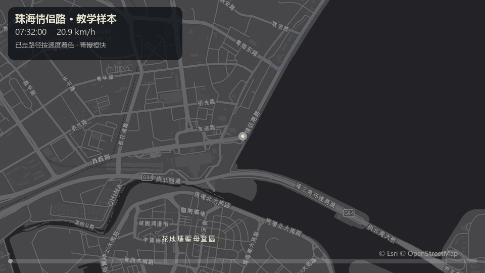

# mini-03-kepler-motion ｜ 轨迹时空动画（Kepler.gl）

把 GPS 轨迹变成**带时间轴的动态轨迹动画**：一行命令把 Q2 清洗后的轨迹转为 Kepler.gl 格式，在浏览器里零代码配置出专业级时空动画——轨迹随时间轴播放、速度着色、暗色底图，导出动图即可嵌入任意 README。



## 项目特点

- **零代码可视化**：Kepler.gl（Uber 开源）浏览器端本地处理数据，不上传服务器
- **一条命令转换**：`convert.py` 自动从 Q2 项目的清洗结果生成 Kepler 友好格式（timestamp / lat / lon / speed / elevation）
- **隐私友好**：数据在浏览器本地渲染；仓库不含任何轨迹数据（`data/` 已被 `.gitignore` 排除）

## 快速开始

```bash
pip install -r requirements.txt

# 转换轨迹（默认读取 ../mini-02-gps-tracks/outputs/track_cleaned.csv，
# 也可指定任意含 time/lat/lon 列的 CSV）
python convert.py
# 或：python convert.py path/to/your_track.csv
```

## kepler.gl 浏览器操作指引（生成动画）

**第 1 步 · 打开与导入**
1. 浏览器打开 [kepler.gl/demo](https://kepler.gl/demo)
2. 把刚生成的 `data/kepler_track.csv` 直接拖入页面（数据本地处理，不上传）

**第 2 步 · 配置 Trip 图层**
1. 左侧面板点击「Add Layer / 添加图层」→ 类型选择 **Trip（轨迹）**
2. 字段映射确认：Lat = `lat`，Lng = `lon`，Timestamp = `timestamp`
3. Trail Length（轨迹拖尾长度）调到 300–600，拖尾越长视觉越流畅

**第 3 步 · 调优视觉**
1. 底图切换为 **Dark Matter**（暗色底图配亮色轨迹效果最佳）
2. 颜色按 `speed_kmh` 字段做渐变映射——快段红、慢段绿，速度变化一目了然
3. 时间轴（底部）点击播放按钮预览动画；速度档位调 2x–4x（原始 15 分钟的轨迹播完太久）

**第 4 步 · 导出与录制**
1. 用 kepler.gl 自带导出（Share / Export）保存 HTML 快照存档
2. 用免费录屏工具（如 ScreenToGif）录一段播放过程，导出 **≤ 10MB 的 GIF**，命名 `docs/animation.gif`
3. 把 kepler.gl 的 **Save Map（导出配置 JSON）** 保存为 `docs/kepler_config.json`——他人导入即可一键复现同款动画

## 项目结构

```
mini-03-kepler-motion/
├── convert.py               # 轨迹 → Kepler 格式转换器
├── data/kepler_track.csv    # 转换输出（运行时生成，不入库）
├── docs/animation.gif       # 动画成果（导出后放入）
├── docs/kepler_config.json  # Kepler 配置（导出后放入，一键复现）
├── .gitignore
└── requirements.txt
```

## 踩坑记录

1. **Trip 图层对时间格式敏感**：timestamp 必须是标准 ISO 格式（`2026-10-25T08:00:00Z`），且时间需单调递增——`convert.py` 内置了排序与去空处理。
2. **演示数据说明**：本仓库当前示例来自 Q2 项目的**模拟测试轨迹**（珠海周边模拟骑行，含人为漂移点用于测试清洗管线）；正式版将替换为真实运动轨迹，README 与动图同步更新。

## 局限说明

- kepler.gl demo 站点功能以官方当前版本为准（https://docs.kepler.gl）
- GIF 动图文件体积控制在 10MB 内以便 GitHub README 直接展示
- 本项目为个人学习作品（时空数据可视化练习）

## License

MIT
